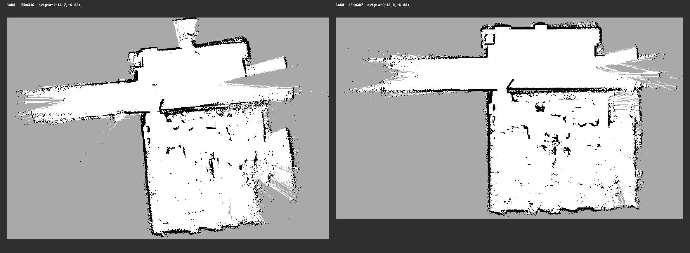

# RoboMaster Sentry Navigation (ROS 2)

基于 ROS 2 Humble 的 RoboMaster 哨兵机器人导航与系统联调工程记录。项目覆盖从激光雷达建图、定位、Nav2 路径规划、全向底盘速度转换、串口通信，到行为树巡逻/回家和 Gazebo 仿真的完整链路。

> 本仓库主要公开导航与联调工作、问题定位过程、验证记录和可复现文档。完整工程快照、构建产物和演示视频通过 GitHub Release 发布，避免把数百 MB 的压缩包直接写入 Git 历史。

## 项目概览

| 模块 | 主要工作 |
| --- | --- |
| 建图与定位 | Mid-360、Point-LIO、slam_toolbox、small-GICP、`map -> odom` 发布 |
| 导航 | Nav2、Theta* 全局规划、全向 PID/MPC 控制器、速度平滑 |
| 底盘适配 | `fake_vel_transform` 速度坐标转换、底盘/云台双自转场景适配 |
| 串口通信 | `rm_serial_driver`、CRC16、115200 波特率、底盘速度帧与姿态中继 |
| 决策树 | 巡逻、低血回家、回血后恢复巡逻、目标超时与重试 |
| 仿真 | Ignition Gazebo 6、RMUL 2027 3V3 场地、2D/3D 地图转换 |
| 工程化 | 启动手册、版本差异、台架复现、静态验证和故障定位报告 |

## 系统链路

```text
Mid-360 LiDAR / IMU
        │
        ▼
Point-LIO / Terrain Analysis
        │
        ├──────────────► SLAM / small-GICP localization
        │                              │
        ▼                              ▼
Nav2 global planner ──► controller_server ──► velocity_smoother
                                                   │
                                                   ▼
                                        fake_vel_transform
                                                   │
                                                   ▼
                              /red_standard_robot1/cmd_vel
                                                   │
                                                   ▼
                                  rm_serial_driver (CRC16)
                                                   │
                                                   ▼
                                      STM32 chassis / gimbal
                                                   │
                                                   ▼
                               Omni-directional wheels + gimbal
```

## 主要问题与修复

### 1. 建图翻译官 tf2 死锁

- 现象：`obstacle_scan` 偶发掉到 0 Hz，上游点云和里程计仍正常，`/map` 随之冻结。
- 定位：通过隔离域复现和 gdb 锁主分析，确认 `MessageFilter::waitForTransform` 与 TF 监听线程存在 AB-BA 死锁。
- 修复：绕开 `MessageFilter` 等待路径，直接订阅点云并在回调内执行 TF 转换；TF 过旧时丢帧。
- 结果：台架连续运行不再出现静默卡死，实车建图链路恢复稳定。

### 2. `map -> odom` 与 local plan 时间戳问题

- `map -> odom` 统一使用当前节点时间发布，避免旧点云时间戳冻结全局 TF。
- Nav2 控制器重新给输入 pose 打当前时间戳，避免旧 `local_plan` 让速度同步分支一直等待。
- 对 local plan 增加 0.5 秒过期判断，超时后绕过同步等待，防止“控制器还活着但速度不下发”。

### 3. small-GICP 并发与定位限幅

- 将 TF 发布从依赖单线程 timer 改为独立线程，避免执行器繁忙时发布饥饿。
- 为定位结果增加互斥保护，避免发布线程读取正在更新的变换。
- 增加平移和旋转修正限幅，降低错误匹配导致的定位跳变。

### 4. 速度方向与底盘/云台双自转

- 统一 ROS 平面坐标约定：`x` 向前、`y` 向左、`z` 向上。
- 串口侧使用 `cmd_vel_yaw_offset_deg: 90.0` 完成导航坐标到底盘坐标的转换。
- 对导航模式下的底盘恒速自转、云台随动与决策树目标点执行进行了联调验证。

### 5. 决策树稳定性

- 巡逻和回家分支改为反应式结构，避免状态消息短暂缺失时打断整棵树。
- 低血阈值 `300`，回血恢复阈值提升到 `580`，消除阈值附近的目标抖动。
- 导航目标增加内外两层 45 秒超时和失败重试。
- 距离目标 `0.20 m` 内稳定 1 秒判定到达，解决 Nav2 在终点附近持续微调导致的卡住。

## 版本演进

| 版本 | 核心变化 |
| --- | --- |
| `v1.0` | 整理后的可运行基线：NaN 防护、翻译官死锁修复、TF/GICP 修复、决策树反应式改造 |
| `v1.1` | 尝试直接使用 `odom -> base_footprint` 的底盘角补偿速度方向，属于中间方案 |
| `v2.0` | 修复 local plan/pose 时间戳，恢复由电控处理 `gimbal -> chassis` 的坐标转换 |
| `v2.1` | small-GICP 独立发布线程、结果互斥保护、Gazebo 2027 场地接入 |
| `v3.0` | 决策树回血阈值、巡逻点、外层超时、无限重试和近目标到达判定 |
| `v3.1` | 与 v3.0 内容逐文件一致，用于验证打包结果，不代表新的功能修改 |

详细差异见 [`docs/versions/`](docs/versions/)。

## 实验室地图

当前实车主要使用 `lab9` 地图，包含实验室内部和门外走廊。仓库中提供二维栅格图、地图元数据和预览图。



## 文档导航

- [哨兵机器人运行方案](docs/operations/哨兵机器人运行方案.md)
- [版本变更总览](docs/versions/版本总览-QY导航.md)
- [Mid-360 建图与目标点指南](docs/bringup/Mid360建图与发目标点指南.md)
- [CCUTVision 串口与导航对接说明](docs/integration/CCUTVision-串口与导航对接说明.md)
- [翻译官 tf2 死锁根因](docs/bugfixes/建图失败根因-翻译官tf2死锁.md)
- [翻译官修复与回退说明](docs/bugfixes/翻译官修复-说明与回退-20261013.md)
- [决策树离线验证报告](docs/verification/决策树验证报告-20261019.md)

## 演示视频

<!-- 发布视频后，把下面的链接替换为 B 站或 GitHub Release 链接。 -->

> 演示视频：待补充

建议演示内容：

1. 导航模式下底盘自转，同时小车向 RViz 目标点平移。
2. 决策树自动巡逻、低血回家、回血后恢复巡逻。
3. 实验室到门外走廊的建图结果和目标点导航。

## Release 内容

完整源码压缩包和视频体积较大，不进入普通 Git 提交，统一放在 Releases：

- `robomaster-sentry-nav-v3.0-public.zip`：v3.0 公开源码快照，已去除备份，并包含视觉、导航共用的 `rm_serial_driver` 与 `auto_aim_interfaces`
- `robomaster-sentry-nav-v3.0-public.zip.sha256`：压缩包校验值
- 演示视频：MP4 文件或外部视频链接

本仓库只对外发布 v3.0 这一个源码附件；v1.0、v1.1、v2.0、v2.1、v3.1 的压缩包保留在本机，不单独上传。

发布步骤见 [`RELEASE_UPLOAD.md`](RELEASE_UPLOAD.md)。

## 运行环境

- Ubuntu 22.04
- ROS 2 Humble
- Nav2
- PCL / Eigen / small-GICP
- Livox Mid-360
- Ignition Gazebo 6

## 仓库范围说明

- 本仓库不包含队内完整视觉算法、账号、密钥或比赛敏感配置。
- 文档中的内网地址使用 `192.0.2.x` 文档示例地址，实车使用前请按现场网络替换。
- 本项目为团队工程记录，未附开源许可证；未明确授权不代表允许商业复用或再分发。

---

如果这个项目对你有帮助，欢迎通过 Issue 交流 ROS 2 导航、串口联调和多坐标系问题。
